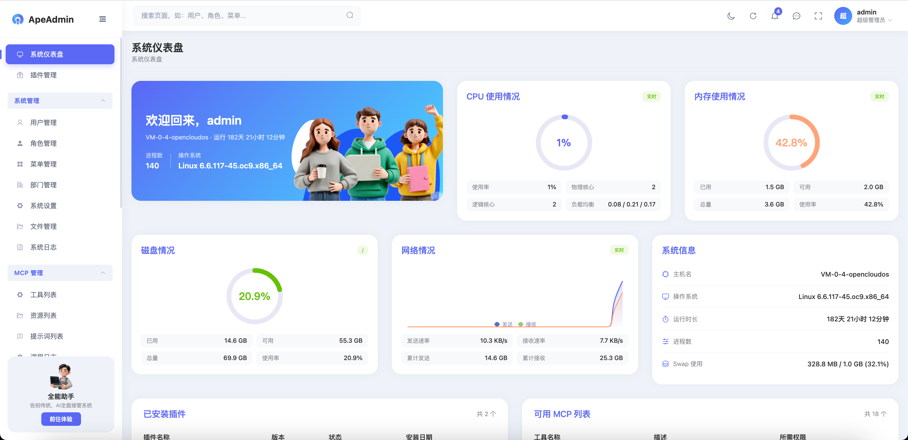
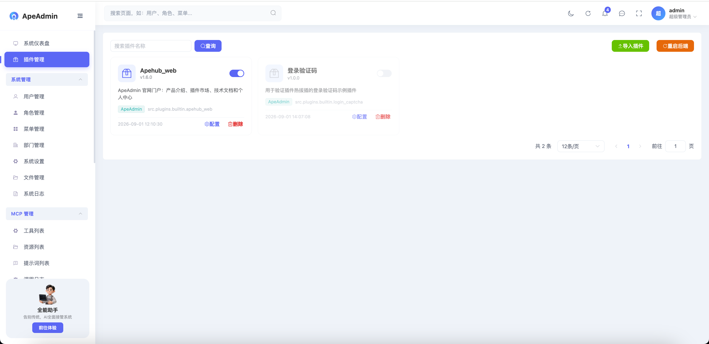
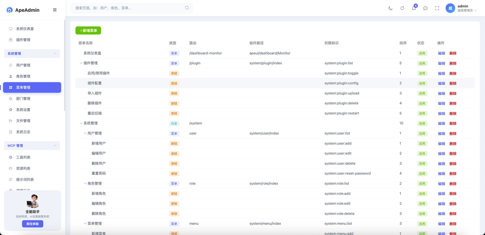
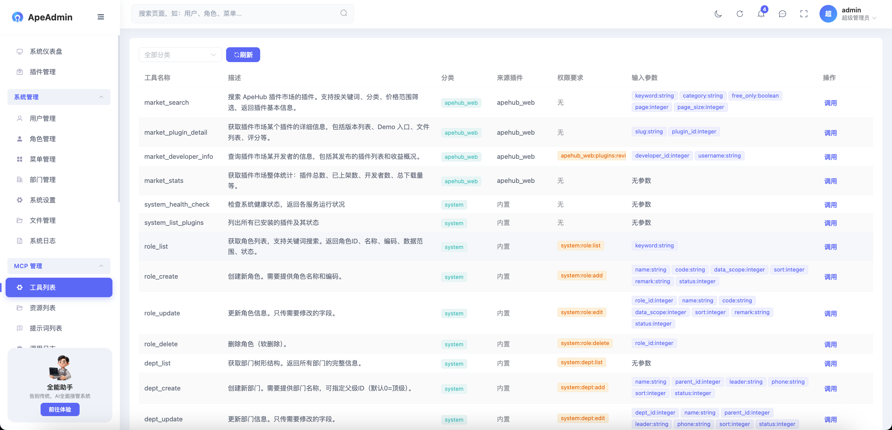

<div align="center">
  <br/>
  
  <h1>ApeAdmin-Spring</h1>
  <p> The Java implementation of ApeAdmin · Spring Boot 3 + Vue3 · 100% open-source admin framework</p>
</div>

<p align="center">
  <a href="http://apehub.finecv.cn/apehub-web">Website</a> ·
  <a href="http://apehub.finecv.cn/apehub-web/plugins.html">Plugin Market</a> ·
  <a href="http://apehub.finecv.cn/apehub-web/docs-portal">Docs</a> ·
  <a href="https://apehub.finecv.cn/admin">Live Demo</a> ·
  <a href="#features">Features</a> ·
  <a href="#architecture">Architecture</a> ·
  <a href="#configuration">Configuration</a> ·
</p>

<p align="center">
  <a href="README.md">简体中文</a> | English
</p>

<p align="center">
  
  
  
  
  
</p>

---

> **This project is AI-driven, human-governed.** ApeAdmin iterates efficiently with AI assistance: human developers own product direction, architecture reviews, quality validation and final decisions, while AI accelerates implementation, testing and documentation.

---

ApeAdmin-Spring is the **Java implementation** of [ApeAdmin](https://apehub.finecv.cn/apehub-web) (the original Python edition is built on FastAPI). The two editions keep their **API contracts and semantics aligned one by one**: identical REST APIs (`/api/v1`, globally snake_case fields), the same Vue3 admin frontend, and the same feature surface (RBAC / AI chat / MCP gateway / plugin system). Pick either edition based on your team's stack, or run both side by side.

The base platform ships with enterprise-grade capabilities including RBAC access control, audit logging and file management. The integrated MCP gateway wraps base-platform and plugin capabilities into standardized AI tools that Agents can call. The AI assistant supports multi-model streaming chat and Function Calling. The project is released under the MIT license.

## Features

### RBAC Access Control

- **Five-table model** — users / roles / menus / departments + relation tables, standard RBAC infrastructure
- **Four permission layers** — public → exempt → rule-based authorization → data scope (own department / department & below / all), with data scope rewritten into SQL automatically by MyBatis-Plus interceptors
- **Three menu types** — directory (M) / menu (C) / button (F), unlimited-depth tree structure
- **Super-admin wildcard** — super administrators automatically hold all permissions; regular users are granted per role-menu assignment
- **Dynamic routing** — frontend routes are generated from the backend menu tree; the `v-permission` directive controls button-level visibility

### AI Chat

- **Multi-model support** — DeepSeek / Qwen (Tongyi Qianwen) / Zhipu GLM / OpenAI / custom endpoints, all via OpenAI-compatible interfaces
- **Streaming SSE** — streaming output + real-time Markdown rendering + code highlighting
- **Parallel Run architecture** — sessions and runs are decoupled; messages are persisted with interrupt and state recovery
- **Function Calling** — the AI can invoke system tools to perform admin operations (user CRUD / system stats); tool names are automatically sanitized to satisfy naming constraints of DeepSeek and similar providers
- **Quota control** — chat quota semantics match the Python edition (over-limit returns 429 with a limit hint)
- **Key management** — manage AI provider keys in the backend, stored encrypted

### MCP Gateway

Exposes base-platform and plugin capabilities as tools that AI Agents can call:

- **Three primitives** — Tools (invocation) / Resources (reading) / Prompts (template rendering)
- **RBAC filtering** — an Agent only sees tools the current user is permitted to call, re-validated at execution time
- **Unified AI tool surface** — MCP tools and system tools are exposed together to the AI assistant for Function Calling
- **Audit logging** — every tool call is logged with request, response, latency and caller (semantics aligned with the Python edition)
- **Built-in registration** — built-in tools / resources / prompts are registered automatically at startup (idempotent overwrite)

Built-in MCP tools:

| Tool | Description |
|------|------|
| `system_health_check` | System health check |
| `system_list_plugins` | List installed plugins |
| `role_list / create / update / delete` | Role management (RBAC enforced) |
| `dept_list / create / update / delete` | Department management (RBAC enforced) |
| `menu_list / create / update / delete` | Menu management (RBAC enforced) |

Also includes 3 built-in resources (system status / user stats / system info) and 1 prompt template (`system_summary`).

### Three-Level Plugin System

- **L1 static registration** — compile-time plugins: Spring beans implementing the `ApePlugin` interface, discovered at startup, enabled/disabled from the admin UI
- **L2 ZIP hot-loading** — upload a ZIP (whitelist validated) → dynamically load implementation classes via URLClassLoader; plugins may register MCP tools and event listeners
- **L3 MCP external servers** — standalone MCP servers (stdio JSON-RPC) whose tools are proxied by the gateway; configured with command / args / env
- **EventBus** — loosely coupled event communication between plugins
- **Dev example** — a bundled `dev_example` plugin covering the full chain: routes / tools / events

### System Management & Auditing

- **File management** — two-level folders/files, upload and download (50MB per file)
- **Login protection** — slider captcha + login logs
- **Operation logs** — recorded automatically via the `OperateLog` annotation + AOP aspect, filterable by module, time and user
- **Data masking** — unified masking at the serialization layer (phone numbers / emails, etc.)

### Dashboard

- **Host monitoring** — real-time CPU / memory / disk metrics powered by OSHI
- **Business stats** — users / roles / menus / plugins / online users, and more

### One-Click Self-Update

- **In-backend update** — System Settings → Version: check for updates / upload an update package; SHA256 verified, old package backed up, jar replaced and restarted
- **Supervised restart** — the convention exit code 90 means "update complete"; the `apeadmin-start.sh` / `.bat` supervisor scripts (or Docker `--restart`) automatically bring up the new version
- **Login state preserved** — Sa-Token sessions are persisted to SQLite, so logins survive update restarts

## Tech Stack

| Layer | Technology |
|---|---|
| Language / runtime | Java 21 (virtual threads carry SSE long connections and tool calls) |
| Backend | Spring Boot 3.5.13 + MyBatis-Plus 3.5.18 + Flyway 12.4 |
| Authentication | Sa-Token 1.46 (JWT Bearer, sessions persisted to SQLite) |
| Database | SQLite (default profile, WAL) / MySQL — dual profiles, switchable |
| Monitoring | OSHI 6.9 (CPU / memory / disk) |
| Frontend | Vue 3.5 + Vite + TypeScript + Element Plus (build output embedded at `static/admin`, source shared with the Python edition) |
| AI protocol | MCP (HTTP API + stdio external-server proxy) |
| AI models | DeepSeek / Qwen / Zhipu GLM / OpenAI (OpenAI-compatible interfaces) |
| Build | Maven multi-module + spring-boot-maven-plugin fat jar |

## Quick Start

### Live Demo

No setup needed — visit the hosted demo (deployed from the Python edition; both editions share the same frontend and feature surface):

- **URL**: <https://apehub.finecv.cn/admin>
- **Account**: `ceshi110`
- **Password**: `ceshi110`

> The demo account is a read-only viewer role: it can browse module data but cannot create, update or delete.

### Option 1: Build from source

Requires JDK 21 + Maven:

```bash
mvn -q package -DskipTests
java -jar ape-server/target/apeadmin.jar
```

Open `http://127.0.0.1:18080/admin/`; Flyway creates the schema and seeds initial data automatically:

- **Default account**: `admin`
- **Default password**: `ApeAdmin@2026` (change it immediately after first login)

### Option 2: Release package (recommended for production)

```bash
# Build the release package (produces release/dist/apeadmin-spring-<version>.zip + SHA256)
./release/package-release.sh 1.0.1

# Unzip and run (supervisor script; exit code 90 auto-restarts after self-update)
unzip apeadmin-spring-1.0.1.zip && cd apeadmin-spring-1.0.1
sh apeadmin-start.sh        # Windows: double-click apeadmin-start.bat
```

The release package contains only `apeadmin.jar` + startup scripts + notes — no runtime state ever enters the package (database / uploads / plugins / keys are all excluded).

### Option 3: Docker

```bash
docker build -t apeadmin-spring:latest .
docker run -d --name apeadmin \
  -p 18080:18080 \
  -v apeadmin-data:/app/data \
  -e APE_JWT_SECRET=<change-me-in-production> \
  --restart unless-stopped \
  apeadmin-spring:latest
```

All runtime state (SQLite database / uploads / plugins) lives under `/app/data`; mount a volume to persist it.

### Switching to MySQL

SQLite starts with zero configuration by default; to switch to MySQL in production, just change the profile and provide connection info:

```bash
java -jar ape-server/target/apeadmin.jar \
  --spring.profiles.active=mysql \
  -DMYSQL_HOST=127.0.0.1 -DMYSQL_PORT=3306 \
  -DMYSQL_DB=apeadmin -DMYSQL_USER=root -DMYSQL_PASSWORD=xxx
```

### Suggested Walkthrough

1. Log in to the admin backend (default `admin / ApeAdmin@2026`)
2. System Management → Users / Roles / Menus / Departments / Files / Plugins / Logs / Settings
3. MCP Management → Tools / Resources / Prompts / Call Logs
4. AI Assistant → configure a model key, then start chatting
5. System Settings → Version → one-click update

## Architecture

A Maven multi-module monolith, split vertically by business domain, with the base platform decoupled from business code:

```
apeadmin-spring/
  ape-dependencies/            # Dependency BOM (unified versions: Spring Boot / Sa-Token / MyBatis-Plus / Flyway / SQLite / OSHI)
  ape-common/                  # Common base (unified response R / error codes / pagination / permission constants / utilities)
  ape-framework/               # Framework layer (starter-style, split by capability)
    ape-framework-web/         #   Global exception handling / SSE helpers / data masking
    ape-framework-mybatis/     #   BaseDO / audit-field filling / data permission (DataScope 4-layer SQL rewrite)
    ape-framework-log/         #   Operation-log annotation + AOP aspect
    ape-framework-redis/       #   Redis support (reserved)
  ape-modules/                 # Business modules
    ape-system/                #   RBAC (users/roles/menus/departments) + auth + files + logs + settings + self-update
    ape-chat/                  #   AI chat (provider management / SSE streaming / Run engine / system tools / quotas)
    ape-mcp/                   #   MCP gateway (tool/resource/prompt registration & invocation / auditing)
    ape-plugin/                #   Plugin system (L1 static / L2 ZIP hot-loading / L3 stdio external) + EventBus
  ape-server/                  # Bootstrap + dashboard (OSHI) + Flyway migrations + embedded frontend (static/admin)
  release/                     # Release artifacts (supervisor startup scripts / package-release.sh / dist)
  Dockerfile                   # Containerization (JRE 21, data under /app/data)
```

### Design Principles

1. **Contract alignment** — REST API paths, fields (globally snake_case), error codes and semantics stay aligned one by one with the Python edition; both editions share one frontend codebase and can be swapped seamlessly
2. **Base-business decoupling** — the framework layer provides only starter capabilities; all business code lives in the ape-modules; dependencies flow one way
3. **Dual databases** — SQLite for zero-config local development, MySQL for production, switched via profile; Flyway handles migrations and seed data automatically
4. **Virtual threads** — Java 21 virtual threads carry SSE long connections and MCP tool calls, delivering high concurrency at low cost
5. **Permissions reach the AI** — MCP tool calls and AI Function Calling are both governed by RBAC; an Agent can only operate resources it is permitted to
6. **Supervised self-update** — the convention exit code 90 lets supervisor scripts / Docker restart bring up the new version; update packages are SHA256-verified with old-package backup and login-state preservation

## Configuration

Core configuration lives in `ape-server/src/main/resources/application.yml` (overridable via environment variables / startup arguments):

| Option | Default | Description |
|--------|---------|------|
| `server.port` | 18080 | Service port |
| `spring.profiles.active` | sqlite | Database profile (sqlite / mysql) |
| `MYSQL_HOST` / `MYSQL_PORT` | 127.0.0.1 / 3306 | MySQL address (mysql profile) |
| `MYSQL_DB` / `MYSQL_USER` / `MYSQL_PASSWORD` | apeadmin / root / — | MySQL database name and credentials |
| `APE_JWT_SECRET` | built-in dev default | JWT signing key — must be changed in production |
| `sa-token.timeout` | 86400 | Login session lifetime (seconds) |
| `spring.servlet.multipart.max-file-size` | 50MB | Per-file upload limit (100MB total per request) |
| `ape.upload-dir` | ./uploads | Upload directory (created automatically) |
| `ape.plugin.dir` | ./plugins | Plugin directory (L2 unpacking / L3 registration persistence) |
| `APE_APP_VERSION` | 1.0.0 | Running version (injected by startup scripts / Docker, compared during self-update) |

### AI Model Configuration

Add providers under Admin Backend → AI Assistant → Model Key Management:

| Provider | Default model | Base URL |
|----------|----------|----------|
| DeepSeek | deepseek-chat | `https://api.deepseek.com` |
| Qwen (Tongyi Qianwen) | qwen-plus | `https://dashscope.aliyuncs.com/compatible-mode/v1` |
| Zhipu GLM | glm-4-flash | `https://open.bigmodel.cn/api/paas/v4` |
| OpenAI | gpt-4o-mini | `https://api.openai.com/v1` |
| Custom | — | any OpenAI-compatible endpoint |

## Screenshots

<table>
  <tr>
    <td width="50%" align="center">
      <br/>
      <sub><b>Dashboard</b></sub>
    </td>
    <td width="50%" align="center">
      <br/>
      <sub><b>Plugin Management</b></sub>
    </td>
  </tr>
  <tr>
    <td width="50%" align="center">
      <br/>
      <sub><b>Menu Management</b></sub>
    </td>
    <td width="50%" align="center">
      <br/>
      <sub><b>MCP Management · Tools</b></sub>
    </td>
  </tr>
</table>

## Contributing

Contributions are welcome!

### How to contribute

1. **Fork** the repository and clone it:
   ```bash
   git clone https://github.com/<your-username>/ApeAdmin-Spring.git
   cd ApeAdmin-Spring
   ```
2. Create a branch (prefix it with `feat/`, `fix/`, `refactor/`, `docs/` or `chore/`)
3. Make your changes and ensure the build passes:
   ```bash
   mvn clean package -DskipTests
   ```
4. Write a clear commit message (e.g. `feat: add xxx support`)
5. **Push** and open a **Pull Request** against the `master` branch

### Conventions

- Keep API contracts aligned with the Python edition; changes to REST semantics require a dual-edition impact check
- New business capabilities go into the matching `ape-modules` module; no business code in framework or common
- Business plugins stay out of the base repository and release packages; distribute them as standalone plugin packages
- APIs follow RESTful style with the `/api/v1` prefix and snake_case fields
- Make sure `mvn clean package` passes before committing

## Release History

| Version | Date | Highlights |
|------|------|------|
| v1.0.1 | 2026-11-21 | Contract-alignment polish: self-update/restart flow, plugin-management interactions, MCP audit and dashboard fully aligned with the Python contracts; AI tool names sanitized for DeepSeek; Sa-Token sessions persisted to SQLite; menu/department tree selectors, real 401 status codes and other fixes |
| v1.0.0 | 2026-11-20 | First release: M1 base skeleton & RBAC → M2 AI chat (SSE streaming + Run engine) → M3 MCP gateway → three-level plugin system + file management → M4 dashboard & release pipeline → M5 frontend contract endpoints |

## Community

---

Scan the QR code below with WeChat to join the ApeAdmin user group — report issues, share tips, and chat with other users and maintainers:

<p align="center">
  
</p>
